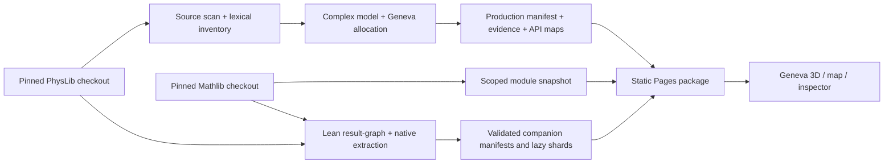

# Architecture and codebase map

Read [Handover](HANDOVER.md) for verified revision/counts, [Development](DEVELOPMENT.md) for reproduction, and [AGENTS](../AGENTS.md) for contribution boundaries.

## Data flow

All stages are static-build or browser-local. No hosted backend, vector database, LLM API call or runtime Lean compiler is required by the current city.

## Locate the code

| Responsibility | Entry point(s) |
|---|---|
| CI, production build and publication | [deploy.yml](../.github/workflows/deploy.yml), [preview checks](../.github/workflows/city-v2-ci.yml) |
| Source module scan and validation | [extract.mjs](../scripts/extract.mjs), [validate.mjs](../scripts/validate.mjs), [graph contract](graph-data-contract.md) |
| Lexical command inventory | [city-v2-inventory.mjs](../scripts/city-v2-inventory.mjs), [validate-declarations.mjs](../scripts/validate-declarations.mjs) |
| Mathlib imports and revision pin | [extract-mathlib.mjs](../scripts/extract-mathlib.mjs), [mathlib-pin.mjs](../scripts/mathlib-pin.mjs) |
| Canonical complex grouping and ownership | [city-v2-model.js](../site/city-v2-model.js), [geneva-contributor.js](../site/geneva-contributor.js) |
| Geography and deterministic source placement | [geneva-g1-geometry.js](../site/geneva-g1-geometry.js), [geneva-production-layout.js](../site/geneva-production-layout.js), [geneva-civic-fabric.js](../site/geneva-civic-fabric.js) |
| Build manifest and evidence | [build-geneva-production.mjs](../scripts/build-geneva-production.mjs), [build-geneva-evidence.mjs](../scripts/build-geneva-evidence.mjs), [build-geneva-history.mjs](../scripts/build-geneva-history.mjs) |
| Lean extraction | [elaborated-pilot.yml](../.github/workflows/elaborated-pilot.yml), [native-lean-metadata.lean](../scripts/native-lean-metadata.lean), [adapt-result-city.mjs](../scripts/adapt-result-city.mjs), [pack-native-metadata.mjs](../scripts/pack-native-metadata.mjs), [publish-elaborated.mjs](../scripts/publish-elaborated.mjs) |
| Current application | [geneva-g1.html](../site/geneva-g1.html), [geneva-g1.js](../site/geneva-g1.js) — orchestration, DOM, scene, camera, selection |
| Visible city projection | [geneva-city-scope.js](../site/geneva-city-scope.js), [geneva-breathing-city.js](../site/geneva-breathing-city.js), [geneva-topdown-plan.js](../site/geneva-topdown-plan.js) |
| Skywalks, role markers and utility evidence | [geneva-network-hierarchy.js](../site/geneva-network-hierarchy.js), [geneva-beam-network.js](../site/geneva-beam-network.js), [geneva-legibility.js](../site/geneva-legibility.js) |
| Architecture, materials, water and labels | [geneva-architectural-materials.js](../site/geneva-architectural-materials.js), [geneva-district-lighting.js](../site/geneva-district-lighting.js), [geneva-role-signatures.js](../site/geneva-role-signatures.js), [geneva-night-terrain.js](../site/geneva-night-terrain.js), [geneva-city-labels.js](../site/geneva-city-labels.js), [geneva-civic-render.js](../site/geneva-civic-render.js) |
| Camera and detail | [geneva-navigation.js](../site/geneva-navigation.js), [geneva-landing-frame.js](../site/geneva-landing-frame.js), [geneva-lod.js](../site/geneva-lod.js) |
| Inspector and API maps | [geneva-source-inspector.js](../site/geneva-source-inspector.js), [geneva-api-maps.js](../site/geneva-api-maps.js), [geneva-api-map-panel.js](../site/geneva-api-map-panel.js) |
| Declaration traversal and metadata | [geneva-declaration-navigation.js](../site/geneva-declaration-navigation.js), [geneva-elaborated.js](../site/geneva-elaborated.js), [geneva-elaborated-panel.js](../site/geneva-elaborated-panel.js), [geneva-native-metadata.js](../site/geneva-native-metadata.js) |
| Packaging and tests | [package-site.mjs](../scripts/package-site.mjs), [smoke-geneva-browser.mjs](../scripts/smoke-geneva-browser.mjs), [test directory](../test) |

## Generated data (not tracked source)

All paths are under site/data before packaging, dist/site/data afterwards.

| Artifact | Meaning |
|---|---|
| graph.json | Versioned explicit source module imports and map references |
| declarations.json | Lexical source command inventory, not elaborated declarations |
| mathlib.json / mathlib-bridge.json | Scoped pinned Mathlib module imports and bridge evidence |
| geneva-production.json | Complex model, layout, ownership, lexical records, API maps, evidence |
| geneva-history.json | Optional revision-sampled history |
| geneva-elaborated-manifest.json / geneva-elaborated.json | Optional hash-verified scoped result graph, lazy-loaded |
| geneva-native/manifest.json + module shards | Optional matching exact native signatures, source ranges, direct type/value refs |

Never edit these JSON files to change mathematics; regenerate them. Provenance lives in the artifacts themselves, not just the UI status.

## Semantic model versus visual view
Library and module IDs are source-derived. Complex/role grouping is inferred from source hierarchy and commands; it is not the planned K0 canonical declaration schema. Module imports go dependent → prerequisite. Scoped result-graph edges may be contracted; native direct refs are different evidence. A displayed macro corridor is an aggregate of recorded complex edges, not a new declaration or mathematical dependency. Mathlib stations are local references, not a rendering of Mathlib. Rendered geometry/lighting/selection are projections; decorative scenery is not part of the graph.

## Runtime rendering
Three.js instanced main scene draws on demand, while a separate transparent renderer handles animated skywalks, district pulse and river glints. High DPR is capped by device limits and 12 MP. The SVG navigation map consumes the same layout/projection. State orchestration currently lives in geneva-g1.js; future decomposition should be incremental, tested, and driven by an issue rather than a rewrite.

## Compatibility and code retention
The old C.4 explorer, city-v2 source preview, city-* modules, assets and legacy test suite are deliberately retained because package-site, asset validation, compatibility URLs, and some shared model/data helpers still depend on them. Public index and geneva-g1.html are the same current landing page; city-v2.html in the package redirects, city-c4.html is historical. The raw site/index.html is a legacy build input, not production. Do not delete or rename these modules just because they predate Geneva. Use the dependency graph/tests to plan a separate compatibility retirement if needed. Dated designs and evidence are archived in Git history; [documentation index](README.md) is the current navigation entry point.
